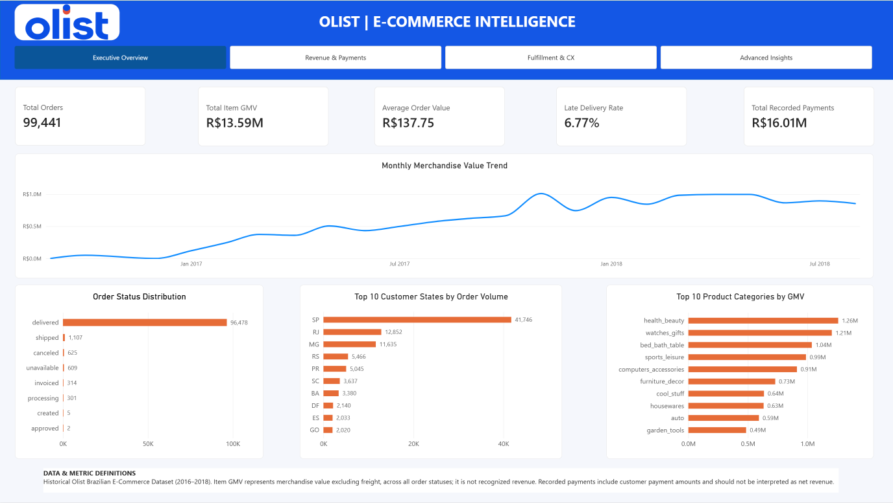
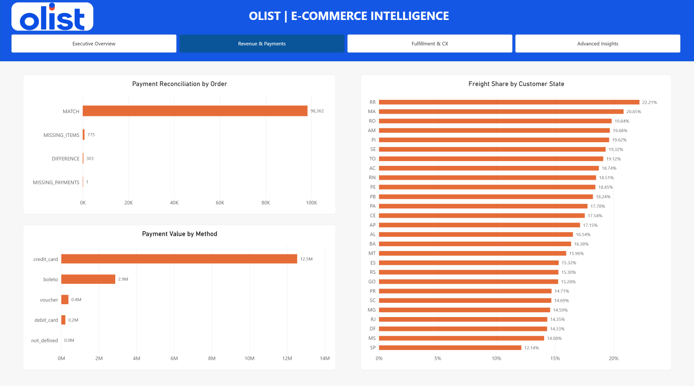
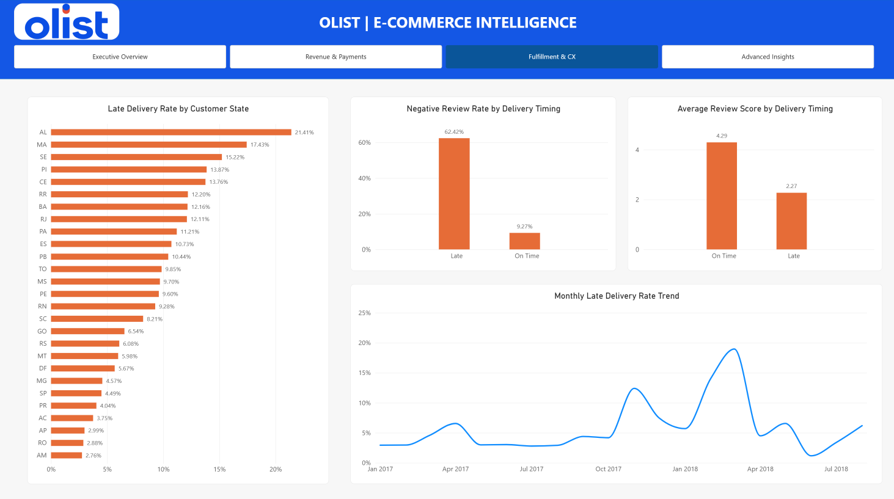
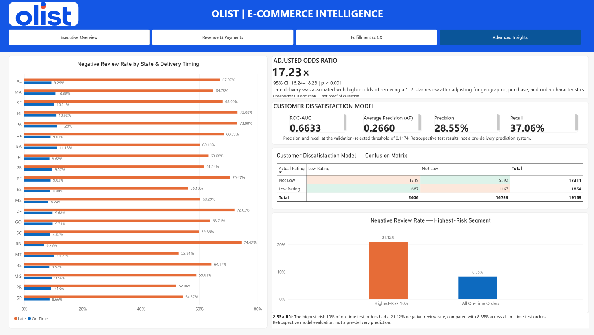

# Olist E-Commerce Intelligence | End-to-End Analytics

**SQL Server • Python • Statistical Analysis • Machine Learning • Power BI**

An end-to-end business intelligence project analyzing historical Brazilian e-commerce transactions to uncover insights into merchandise sales, payment reconciliation, delivery performance, and customer satisfaction.

The project combines SQL-based data warehousing, Python statistical analysis, retrospective machine-learning evaluation, and a four-page interactive Power BI dashboard.

## Dashboard Preview

### Executive Overview

Provides an overview of merchandise value, order volumes, payment totals, customer geography, product categories, and delivery performance.

### Revenue & Payments Intelligence

Analyzes payment methods, order-level payment reconciliation, and the proportion of customer charges attributable to freight across Brazilian states.

### Fulfillment & Customer Experience

Examines delivery punctuality, monthly late-delivery trends, review scores, and the relationship between late deliveries and customer dissatisfaction.

### Advanced Analytics & Insights

Presents regional customer satisfaction comparisons, adjusted logistic regression findings, retrospective classification performance, a confusion matrix, and high-risk customer segments.

## Business Problem

E-commerce businesses need reliable information to understand sales performance, reconcile customer payments, monitor shipping reliability, and improve customer satisfaction.

This project investigates four business questions:

1. Which product categories and customer regions contribute the most merchandise value?
2. How do recorded payments compare with expected item and freight charges?
3. How strongly are late deliveries associated with negative customer reviews?
4. Can retrospective classification identify segments with higher concentrations of dissatisfied customers?

## Dataset

**Source:** [Brazilian E-Commerce Public Dataset by Olist](https://www.kaggle.com/datasets/olistbr/brazilian-ecommerce)

The dataset contains historical Brazilian marketplace transactions from 2016–2018, including customer, order, product, seller, payment, delivery, and review information.

The project uses nine source CSV files and processes:

| Dataset metric | Value |
|---|---:|
| Orders | 99,441 |
| Unique purchasers | 96,096 |
| Order-item records | 112,650 |
| Payment records | 103,886 |
| Products | 32,951 |
| Sellers | 3,095 |

This is historical observational data, not a current live marketplace feed.

## Technology Stack

| Layer | Tools |
|---|---|
| Data storage | Microsoft SQL Server |
| Database management | SQL Server Management Studio (SSMS) |
| Data processing | Python, pandas, NumPy, pyodbc |
| Statistical analysis | SciPy, statsmodels |
| Machine learning | scikit-learn |
| Development | VS Code, Jupyter Notebook |
| Business intelligence | Power BI Desktop, Power Query, DAX |
| Version control | Git, GitHub |

## End-to-End Analytics Workflow

**CSV Sources → SQL Server Staging → Dimensional Warehouse → Analytical Views → Python Analysis → Power BI Dashboard**

### Data Preparation and Warehousing

- Loaded and validated nine CSV datasets in SQL Server.
- Created staging (`stg`), dimensional warehouse (`dw`), and analytical (`analytics`) schemas.
- Developed customer, product, seller, and geography dimensions.
- Developed order, order-item, payment, and review fact tables.
- Standardized data types, missing values, product-category translations, and relevant business rules.
- Created reporting views at appropriate data grains to prevent double-counting across one-to-many joins.
- Validated order counts, payment amounts, and merchandise totals against source data.

### SQL Business Intelligence

Built analytical queries and reporting views to evaluate:

- Merchandise value and order activity
- Customer and product-category performance
- Payment reconciliation
- Freight share by customer state
- On-time and late delivery performance
- Review scores and negative-review rates

### Python Statistical Analysis

Investigated the relationship between delivery punctuality and low customer ratings.

The analysis included descriptive statistics, group comparisons, confidence intervals, a chi-square association test, and adjusted logistic regression.

### Retrospective Machine Learning

Evaluated a regularized logistic classification model using a chronological train, validation, and test strategy.

The evaluation includes ROC-AUC, average precision, precision, recall, confusion-matrix analysis, and high-risk segment lift.

The model uses historical delivery information, so it is **not presented as a validated pre-delivery prediction system**.

## Key Business Findings

### Merchandise and Payment Performance

| KPI | Result |
|---|---:|
| Total Orders | 99,441 |
| Item GMV (excluding freight) | R$13,591,643.70 |
| Recorded Payment Value | R$16,008,872.12 |
| Overall Late Delivery Rate | 6.77% |

Item GMV represents the sum of recorded item prices across all order statuses. It does not represent recognized or net revenue.

### Payment Reconciliation

| Reconciliation category | Orders |
|---|---:|
| Matched | 98,362 |
| Missing item records | 775 |
| Payment differences | 303 |
| Missing payment records | 1 |

The reconciliation compares recorded payments with item-plus-freight charges at the order level.

Differences indicate records requiring investigation, not automatically fraud or realized financial loss.

### Delivery Reliability and Customer Satisfaction

Among eligible delivered orders with valid reviews:

| Metric | On Time | Late |
|---|---:|---:|
| Reviewed orders | 89,443 | 6,381 |
| Average review score | 4.29 / 5 | 2.27 / 5 |
| Negative review rate (1–2 stars) | 9.27% | 62.42% |

**Key finding:** Negative reviews were approximately **6.74 times as common** among late deliveries as among on-time deliveries.

The negative-review-rate difference was approximately **53.15 percentage points**.

### Adjusted Statistical Analysis

An adjusted logistic regression estimated:

- **Adjusted odds ratio:** 17.23
- **95% confidence interval:** 16.24–18.28
- **Statistical significance:** p < 0.001
- **Analysis sample:** 95,824 eligible reviewed orders

The model adjusted for geographic, temporal, merchandise, freight, and order-level characteristics.

These are associations in observational data and do not establish causation. The odds ratio should not be interpreted as a probability ratio.

### Machine Learning Evaluation

| Test metric | Result |
|---|---:|
| ROC-AUC | 0.6633 |
| Average Precision (AP) | 0.2660 |
| Precision | 28.55% |
| Recall | 37.06% |

Precision and recall were evaluated using a threshold of 0.1174 selected on validation data.

The chronological test set contained 19,165 orders.

Among on-time test orders, the highest-risk 10% had a **21.12% negative-review rate**, versus **8.35% overall**, representing approximately **2.53× lift**.

These findings demonstrate retrospective risk ranking, not operational pre-delivery prediction performance.

## Business Recommendations

Based on the analysis:

1. **Prioritize delivery reliability.** Monitor late-delivery rates and investigate regions or operational periods with elevated delays.
2. **Strengthen customer recovery processes.** Evaluate targeted support workflows for customers experiencing delivery delays.
3. **Investigate payment exceptions.** Review missing records and reconciliation differences, distinguishing operational data issues from genuine financial discrepancies.
4. **Monitor freight affordability.** Compare customer freight charges across regions while considering order volumes and merchandise values.
5. **Use analytics responsibly.** Validate prediction models using information available at the intended decision point before considering operational deployment.

These are proposed actions informed by historical results; their business impact has not been experimentally established.

## Project Structure

- **`data/`** — Source files and reference data
- **`sql/`** — SQL database and analytical scripts
- **`src/`** — Python source code
- **`notebooks/`** — Exploratory analysis, statistical analysis, and model evaluation
- **`dashboard/`** — Power BI report and screenshots
- **`reports/`** — Business reporting and analytical figures
- **`docs/`** — Supporting project documentation
- **`tests/`** — Data-quality and validation tests, where implemented

## Dashboard Access

The four Power BI dashboard screenshots are available above.

The report was developed in Power BI Desktop and is not publicly hosted in Power BI Service.

Where the PBIX file is included in the repository, users can open it with Power BI Desktop. Refreshing SQL Server data may require configuring their own accessible database connection.

## Limitations

- The dataset is historical and does not reflect current Olist business performance.
- The final months have incomplete transaction coverage, so some monthly charts use restricted reporting periods.
- Item GMV includes all recorded order statuses and should not be labeled recognized revenue.
- Some geographic subgroups have small samples, requiring care when interpreting rates.
- Statistical findings are observational.
- Machine-learning results are retrospective and depend partly on information unavailable before delivery.
- Certain model metrics and analytical summaries are static findings rather than dynamically recalculated Power BI measures.

## Author

**Sindhu Reddy Naini**

Data Analytics | Business Intelligence | SQL | Python | Power BI